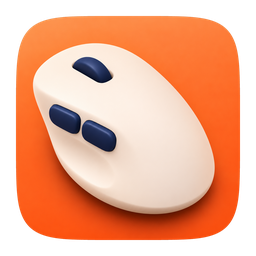
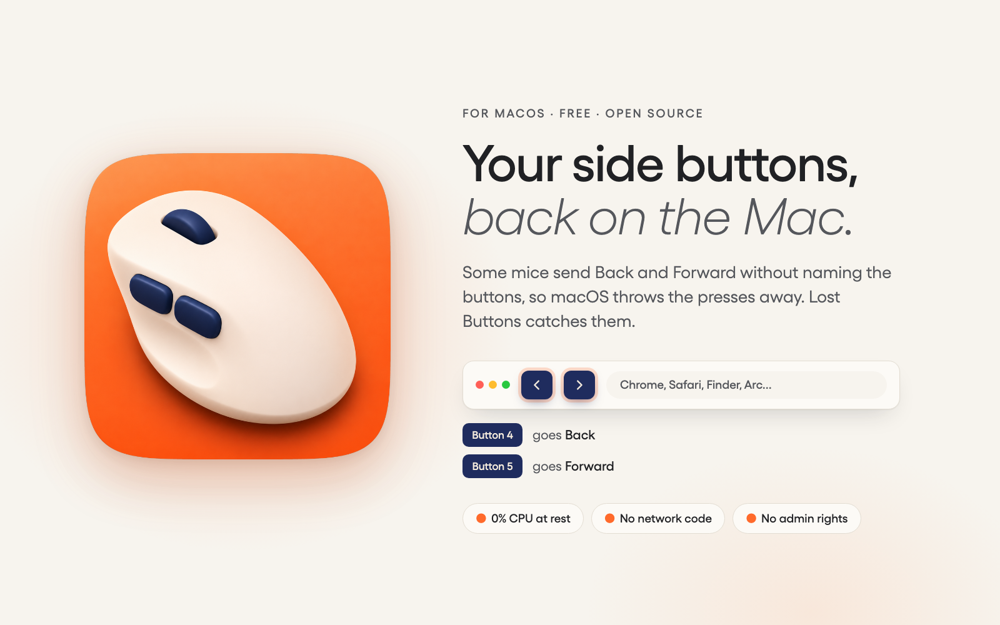

<p align="center"></p>

<h1 align="center">Lost Buttons</h1>

**Your mouse's side buttons, back on macOS.** Some mice have Back and Forward buttons that
work on Windows and Linux but do nothing at all on a Mac. Lost Buttons finds them and makes
them work. Free, open source, sends nothing anywhere. A Saaquib Labs tool. MIT.

<p align="center"></p>

## Set it up in two minutes

**1. Install it.** Open Terminal and paste:

```bash
brew install saaquiblabs/tap/lost-buttons
```

(No Homebrew yet? Get it from [brew.sh](https://brew.sh) first.)

**2. Start it.** This also makes it start by itself every time you log in:

```bash
lost-buttons start
```

macOS shows a notice: *"Lost Buttons" added a background item*. That's expected. It's listed
under **System Settings → General → Login Items & Extensions**, with its icon, where you can switch
it off at any time.

**3. Plug in your mouse.** If it's one Lost Buttons can fix, macOS asks for two permissions.

**4. Allow both.** Open **System Settings → Privacy & Security**, then:
- **Input Monitoring**: switch on **Lost Buttons** (it reads the hidden buttons).
- **Accessibility**: switch on **Lost Buttons** (it passes Back/Forward to your apps).

**5. Try it.** In your browser, press the side buttons: Back and Forward should work. In Finder
and Safari they work too.

**6. Not working?** Check that it's running, and what your Mac sees:

```bash
lost-buttons status
lost-buttons doctor
```

## Is my mouse affected?

```bash
lost-buttons doctor
```

```
• K Chimera [248a:5b4a] via USB
    Fixable: buttons 4–5 are sent but never named, so macOS drops them. Lost Buttons delivers them.
```

If it says *OK* for your mouse and the buttons still don't work, the problem is something else
(try [LinearMouse](https://github.com/linearmouse/linearmouse), which remaps buttons macOS
already sees). If you think it should be fixable, open an issue with `lost-buttons doctor --raw`.

Confirmed: **Kreo Chimera**. Likely: any mouse whose side buttons need a Linux "descriptor fix"
(Rapoo M50 Plus Silent, Rakk Dasig X, some Xiaomi mice). Tell us about yours.

## Why the buttons go missing

Every USB or Bluetooth mouse describes its own reports to the computer (its *HID report
descriptor*). Some cheap or misconfigured firmware says *"5 button bits"* but only names
buttons 1, 2 and 3. macOS goes by the names, so it throws the last two bits away before any app,
or any remapping tool, gets to see them. Linux fixes these mice one model at a time with
descriptor patches.

Lost Buttons reads each mouse's descriptor, spots the unnamed button bits, reads them straight
from the mouse, and sends a normal button 4/5 press. In apps that ignore buttons 4/5 (Safari,
Finder, System Settings, Music, Notes and a few more) it sends ⌘[ / ⌘] instead.

## Light and private by design

| | |
|---|---|
| Opens | Only mice with unnamed buttons. Every other device is never opened. |
| Idle cost | No polling. Wakes only when an affected mouse sends a report. About 5 MB memory, 0% CPU. [Measurements](docs/PERFORMANCE.md). |
| Network | None. There is no networking code. |
| Admin rights | None. No kernel extension, no driver, no root process. Runs as you. |
| Code | Three short Swift files ([`Sources/`](Sources)). Homebrew builds it from source on your Mac. |
| Logs | One line when an affected mouse connects or disconnects. Never key or button contents. |

### Permissions

macOS asks for two, the first time an affected mouse is plugged in:

- **Input Monitoring**: to read the button bits from the mouse, since macOS discards them.
- **Accessibility**: to send the Back/Forward press on to the app you're using.

Both are in **System Settings → Privacy & Security**. If your Mac has no affected mouse,
Lost Buttons asks for nothing and does nothing.

## Upgrade

```bash
brew upgrade lost-buttons
lost-buttons start
```

`start` swaps the running copy for the new one. macOS sees each new build as a new program, so it
may ask for the two permissions again: in Input Monitoring and Accessibility, remove the old
**Lost Buttons** entry (select it, click −), then switch on the new one.

Coming from 0.2 or older, which ran as a Homebrew service? The same two commands: `start` stops
the old service for you.

## Commands

| | |
|---|---|
| `lost-buttons start` | Run in the background now and at every login |
| `lost-buttons stop` | Stop, and don't start at login |
| `lost-buttons status` | Is it running? |
| `lost-buttons doctor` | Which connected mice have dropped buttons (`--raw` adds the descriptors) |

## Uninstall

```bash
lost-buttons stop
brew uninstall lost-buttons
```

Then remove **Lost Buttons** from Input Monitoring and Accessibility in System Settings.

## Build from source

Needs the Xcode Command Line Tools (`xcode-select --install`).

```bash
make test                  # descriptor parser tests
make                       # build/lost-buttons
make app                   # build/Lost Buttons.app (the same binary with a name, icon and login item)
./build/lost-buttons doctor
```

## Licence

MIT © Najmush Saaquib. Issues and pull requests welcome, especially descriptors from mice
that need fixing: [github.com/saaquiblabs/lost-buttons/issues](https://github.com/saaquiblabs/lost-buttons/issues).
